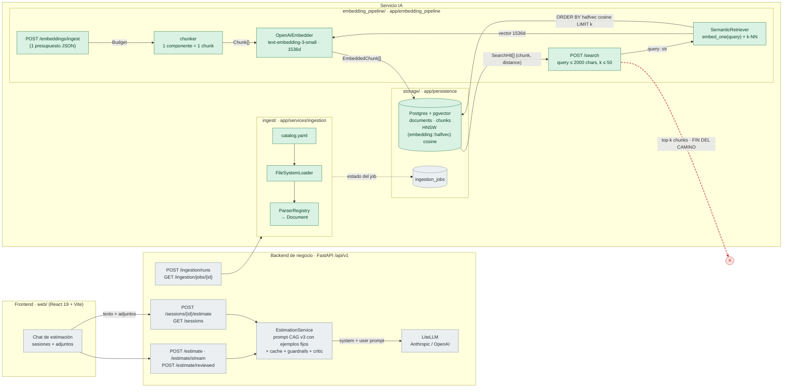
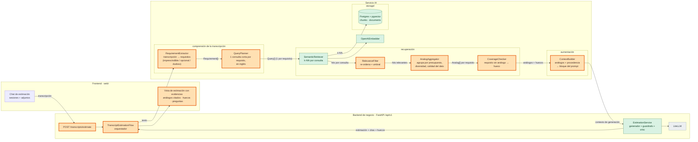

# Diagnóstico arquitectónico — Sesión 09 (pre-work)

Estado del repositorio `estimator-cag` al cierre de la Sesión 08 (rama `session_08`, migración `0003` aplicada).
Trace ejecutado el 2026-11-01 contra la API local (`pnpm dev`, Postgres + pgvector en Docker) con el corpus de
`data/budgets_sample.json`: 17 presupuestos históricos, 60 chunks (1 chunk = 1 componente).

Equivalencia de módulos con el enunciado:

| Enunciado | En este repo |
|---|---|
| `ingest/` | `app/services/ingestion/` (catálogo, loaders, parsers; limpieza y PII aún sin cablear) |
| `embedding_pipeline/` | `app/embedding_pipeline/` (chunker, embedder, ingest service, retriever, routers) |
| `storage/` | `app/persistence/` (SQLAlchemy, `documents` + `chunks` con pgvector, índice HNSW halfvec) |
| backend de negocio | No hay uno separado: la propia API FastAPI (`/api/v1/*`) hace ese papel (sesiones, estimación CAG) |

---

## 1. Diagrama de la arquitectura actual

Leyenda: verde = servicio IA implementado (ingesta, vectorización, búsqueda); gris = frontend y backend de
negocio, que hoy estiman por CAG sin usar el servicio IA;
la línea roja discontinua marca **dónde acaba hoy** el camino de una transcripción.



Lo que se lee en el diagrama:

- **Dos mundos que no se tocan.** La estimación (`EstimationService`) usa CAG: los ejemplos históricos están
  fijos en `app/prompts/estimation/v3/examples.j2` y no hay ninguna flecha desde `/search` hacia el generador.
- **El camino de una transcripción se corta en `/search`.** Devuelve chunks y distancias; nada los agrega por
  presupuesto, nada los pasa a un prompt y nada produce horas. Además, una transcripción real ni siquiera entra:
  `SearchRequest.query` tiene `max_length=2000` (ver el trace).
- La ingesta de ficheros (`ingest/`) y la vectorización (`/embeddings/ingest`) tampoco están conectadas entre sí:
  los presupuestos llegan al vector store como JSON ya normalizado, no desde el pipeline de ingesta.

---

## 2. Trace anotado de `02_ambiguous.txt`

La transcripción tiene **2.929 caracteres y 890 tokens** (`cl100k_base`). Cliente: tienda gourmet física que
quiere vender online. Las necesidades reales, dispersas entre anécdotas: tienda online con catálogo, pago con
tarjeta (y miedo al abandono de carrito), programa de puntos/fidelización, panel de control con pedidos, stock
y gráficas, email de confirmación de pedido, España ahora y quizá Francia después, y la pregunta final:
"¿cuánto cuesta?".

### Paso 1 — Embeber la transcripción completa

Ningún endpoint HTTP devuelve vectores (las respuestas llevan métricas, nunca embeddings, por diseño en S08),
así que el paso 1 usa el mismo módulo que usa `/search` (`OpenAIEmbedder.embed_one`). Desde la raíz del repo:

```bash
uv run python - <<'EOF'
import math, pathlib, tiktoken
from app.dependencies import get_openai_embedder

text = pathlib.Path("examples/transcripts/02_ambiguous.txt").read_text()
vec = get_openai_embedder().embed_one(text)
print({"tokens": len(tiktoken.get_encoding("cl100k_base").encode(text)), "dims": len(vec),
       "first": vec[0], "last": vec[-1], "norm": math.sqrt(sum(v * v for v in vec))})
EOF
```

Respuesta:

```json
{"tokens": 890, "dims": 1536, "first": 0.00624847412109375, "last": 0.0190277099609375, "norm": 1.0003498345455109}
```

> **Comentario.** Es un único vector de 1536 dimensiones con norma ≈ 1 (los embeddings de OpenAI vienen
> normalizados, por eso coseno y producto escalar ordenan igual). Representa el "centroide" de toda la reunión:
> tienda online, pagos, fidelización, panel, emails, pero también el padre, la sobrina, el cuaderno y el primo en
> Francia. No hay forma de saber desde el vector qué necesidad pesa más ni cuál es ruido.

### Paso 2 — Búsqueda semántica (top-5)

**2a. La transcripción completa contra `POST /search`:**

```bash
jq -n --rawfile q examples/transcripts/02_ambiguous.txt '{query: $q, k: 5}' \
  | curl -s -X POST http://127.0.0.1:8000/search -H 'Content-Type: application/json' -d @- \
  | jq '.detail[0] | del(.input)'
```

```json
{
  "type": "string_too_long",
  "loc": ["body", "query"],
  "msg": "String should have at most 2000 characters",
  "ctx": { "max_length": 2000 }
}
```

> **Comentario.** HTTP 422: el endpoint de S08 se diseñó para consultas cortas y rechaza una transcripción real
> (2.929 > 2.000 caracteres). El primer fallo aparece antes de llegar a la base de datos.

**2b. Con el vector completo del paso 1** (mismo `ChunkStore.search` que hay detrás de `/search`):

```bash
uv run python - <<'EOF'
import asyncio, json, pathlib
from app.dependencies import get_chunk_store, get_openai_embedder

text = pathlib.Path("examples/transcripts/02_ambiguous.txt").read_text()
vec = get_openai_embedder().embed_one(text)
hits = asyncio.run(get_chunk_store().search(vec, 5))
for h in hits:
    m = h.metadata
    print(json.dumps({"chunk_id": h.chunk_id, "document_id": h.document_id, "distance": h.distance,
                      "budget": m["budget_id"], "component": m["component_id"],
                      "sector": m["client_sector"], "hours": m["estimated_hours"]}))
EOF
```

```json
{"chunk_id":16,"document_id":5,"distance":0.6082638554117468,"budget":"BUD-2024-005","component":"CATALOG-001","sector":"ecommerce","hours":150}
{"chunk_id":17,"document_id":5,"distance":0.6137695658402417,"budget":"BUD-2024-005","component":"CART-002","sector":"ecommerce","hours":140}
{"chunk_id":18,"document_id":5,"distance":0.6372101753061445,"budget":"BUD-2024-005","component":"RECO-003","sector":"ecommerce","hours":110}
{"chunk_id":19,"document_id":5,"distance":0.6387893787049612,"budget":"BUD-2024-005","component":"STORE-004","sector":"ecommerce","hours":60}
{"chunk_id":27,"document_id":8,"distance":0.6443958392701342,"budget":"BUD-2024-008","component":"RET-001","sector":"ecommerce","hours":140}
```

**2c. Lo que sí acepta `/search`: la transcripción truncada a 2.000 caracteres** (respuesta filtrada con `jq`
para no pegar el `content` completo de cada chunk):

```bash
jq -n --rawfile q examples/transcripts/02_ambiguous.txt '{query: $q[0:2000], k: 5}' \
  | curl -s -X POST http://127.0.0.1:8000/search -H 'Content-Type: application/json' -d @- \
  | jq '{k, search_time_ms, results: [.results[] | {chunk_id, distance, component: .metadata.chunk_id}]}'
```

```json
{
  "k": 5,
  "search_time_ms": 348,
  "results": [
    { "chunk_id": 17, "distance": 0.5972800248459439, "component": "BUD-2024-005::CART-002" },
    { "chunk_id": 16, "distance": 0.6053517785136076, "component": "BUD-2024-005::CATALOG-001" },
    { "chunk_id": 19, "distance": 0.6317185977711585, "component": "BUD-2024-005::STORE-004" },
    { "chunk_id": 18, "distance": 0.6317617596850609, "component": "BUD-2024-005::RECO-003" },
    { "chunk_id": 26, "distance": 0.6399238800511833, "component": "BUD-2024-007::INV-003" }
  ]
}
```

> **Comentario.** El corte cae justo en "¿Tenéis volumen previsto," (minuto 3:40): se pierden los mercados
> (España/Francia), el email de confirmación y la pregunta "cuánto cuesta". El top-5 apenas cambia: cuatro
> componentes del mismo presupuesto de e-commerce en ambos casos.

**2d. Contexto: distancias contra todo el corpus** (los 60 chunks, coseno sobre el vector del paso 1):

```text
n=60  min=0.6082  mediana=0.7026  max=0.7751
top-10: 005::CATALOG-001 0.6082 · 005::CART-002 0.6137 · 005::RECO-003 0.6370 · 005::STORE-004 0.6386
        008::RET-001 0.6443 · 007::INV-003 0.6519 · 017::MVP-006 0.6562 · 017::MVP-004 0.6570
        017::MVP-002 0.6578 · 011::STOCK-002 0.6664
```

> **Comentario.** El mejor resultado tiene similitud ≈ 0,39 y todo el corpus cabe en una franja de 0,17 de
> distancia. El top-5 está separado por solo 0,036. Con esas cifras no hay umbral que distinga "relevante" de
> "lo menos malo".

### Paso 3 — Lectura de los chunks devueltos

| # | Chunk | Presupuesto | Sector | ¿Relevante para Casa Castaño? |
|---|---|---|---|---|
| 1 | `CATALOG-001` Product catalog API (150 h, node/graphql/elasticsearch) | BUD-2024-005 ShopSphere, headless storefront con recomendaciones | ecommerce | **Sí, en parte.** Necesita catálogo, pero Elasticsearch + GraphQL es sobredimensionado para una tienda de conservas y vinos. Las 150 h no se pueden copiar tal cual. |
| 2 | `CART-002` Cart and checkout service (140 h) | BUD-2024-005 | ecommerce | **Sí.** Cubre el pago con tarjeta y el abandono de carrito, que el cliente dice que es "fundamental". El mejor resultado del trace. |
| 3 | `RECO-003` Personalized recommendations (110 h) | BUD-2024-005 | ecommerce | **No.** El cliente no pide recomendaciones. Entra porque viene "en el pack" del mismo presupuesto. Si llega al generador, son 110 h inventadas. |
| 4 | `STORE-004` Storefront PWA (60 h, next.js) | BUD-2024-005 | ecommerce | **Sí.** Es la parte de "que la gente entre, vea los productos y compre". |
| 5 | `RET-001` Returns portal (140 h, .NET) | BUD-2024-008 StyleLoop, devoluciones de moda | ecommerce | **No.** Nadie habla de devoluciones. Está aquí por cercanía de sector, no de necesidad. |

Valoración honesta: **3 de 5 útiles, todas para la misma necesidad (vender online)**. Cuatro de las cinco
posiciones son del mismo presupuesto. No aparece nada para el panel de control (en el corpus existen
`BUD-2024-003::DASH-004` Merchant dashboard y `BUD-2024-014::KPI-004` Operations KPI reporting), ni para el
email de pedido (`BUD-2024-017::MVP-005` Order email, 12 h, y `BUD-2024-001::NOTIF-004`), ni para la
pasarela de pago (`BUD-2024-003::GATE-001`). La fidelización por puntos no tiene ningún análogo en el corpus, y
el sistema no lo dice: simplemente no lo devuelve.

---

## 3. Diagnóstico: cinco fallos identificados

### Fallo 1 — Una transcripción real no cabe en la búsqueda
- **Problema observado:** `POST /search` responde 422 `string_too_long` con la transcripción completa (2.929
  caracteres, límite 2.000). Para que entre hay que truncarla, y el corte (minuto 3:40) borra mercados, email de
  confirmación y la petición de precio (paso 2a/2c).
- **Causa probable:** la búsqueda de S08 se diseñó para consultas cortas tecleadas por un humano; no hay ninguna
  etapa que convierta una transcripción en consultas. La transcripción se trata como si fuera la consulta.
- **Propuesta de solución:** una etapa previa de comprensión de la transcripción que produzca consultas
  derivadas, cortas y completas, de modo que el límite del endpoint deje de ser un problema y no haya truncado.

### Fallo 2 — Un único vector promedia cinco necesidades y solo recupera una
- **Problema observado:** el cliente pide tienda online, pago, fidelización, panel de control y emails, pero el
  top-5 solo cubre "tienda online". Componentes que existen y encajan (`DASH-004`, `KPI-004`, `MVP-005` Order
  email, `GATE-001`) no aparecen ni en el top-10 (paso 2d).
- **Causa probable:** se embebe la reunión entera como un solo vector (paso 1). La necesidad más "parecida" al
  corpus (e-commerce) domina el centroide y tapa las demás.
- **Propuesta de solución:** descomponer la transcripción en una lista de requisitos y recuperar análogos por
  requisito (una búsqueda por necesidad), en vez de una búsqueda por documento.

### Fallo 3 — Distancias comprimidas y sin umbral de relevancia
- **Problema observado:** el mejor chunk está a 0,608 (similitud ≈ 0,39), la mediana del corpus a 0,703 y el
  peor a 0,775. El top-5 cabe en 0,036. Con esos números `RET-001` (devoluciones de moda, irrelevante) puntúa casi
  igual que `CART-002` (el más relevante).
- **Causa probable:** la consulta es larga (890 tokens), ruidosa (marcas de tiempo, anécdotas familiares) y en
  español, frente a chunks cortos, técnicos y en inglés. Además `/search` siempre devuelve `k` resultados, haya o
  no algo relevante: no hay umbral ni segunda pasada que reordene.
- **Propuesta de solución:** consultas limpias y en el idioma del corpus (sale del fallo 2), más una etapa de
  re-ordenación o filtrado por relevancia con un umbral explícito, para que "nada parecido" sea una respuesta
  posible.

### Fallo 4 — Resultados por chunk, redundantes y sin vista de presupuesto
- **Problema observado:** 4 de las 5 posiciones son del mismo presupuesto (`BUD-2024-005`). El 3.º resultado
  (`RECO-003`, 110 h) es irrelevante y entra solo por pertenecer a ese presupuesto. La respuesta no dice cuántas
  horas sumaba el presupuesto, ni qué otros componentes tenía, ni si es un buen referente.
- **Causa probable:** la unidad de recuperación es el chunk (1 componente) y no hay agregación ni diversidad:
  el k-NN puro tiende a devolver vecinos del mismo documento. Tampoco hay señal de calidad: `BUD-2024-017` (un MVP
  "scoped in one-line tickets") aparece en las posiciones 7–9 con el mismo peso que un presupuesto detallado.
- **Propuesta de solución:** una etapa que agrupe los hits por presupuesto, imponga diversidad entre presupuestos
  y adjunte el contexto del presupuesto padre (horas totales, componentes y calidad del dato) a cada análogo.

### Fallo 5 — La recuperación no alimenta a la generación
- **Problema observado:** el trace termina en una lista de chunks. No hay ninguna llamada que, con esos chunks,
  devuelva una estimación: `/api/v1/estimate` genera con los ejemplos fijos de `examples.j2` (CAG) e ignora el
  vector store, y `/search` no conoce al generador (diagrama de la sección 1).
- **Causa probable:** S06–S08 construyeron las dos mitades por separado. Falta la pieza que traduce "análogos
  recuperados" a "contexto del prompt", y el flujo que las une desde una transcripción.
- **Propuesta de solución:** una etapa de aumentación que construya el contexto de generación a partir de los
  análogos (con su procedencia) y un orquestador transcripción → estimación que reutilice el generador
  existente en lugar de los ejemplos fijos.

### Otros

- **Huecos silenciosos.** La fidelización por puntos no tiene análogo en el corpus y el sistema no lo detecta.
  Un generador que reciba el top-5 inventaría esas horas sin avisar. Falta poder decir "sin referencia histórica"
  y convertirlo en una pregunta al cliente.
- **Sector fuera del vocabulario.** "Tienda gourmet" no existe en el `Literal` de sectores (`finance`,
  `ecommerce`, `healthcare`, `industrial`). Un filtro por metadatos no podría expresarlo, y forzarlo a
  `ecommerce` mezcla un marketplace multi-vendor con una tienda familiar.
- **Ambigüedad no modelada.** El cliente dice "no quiero liarlo mucho al principio", "igual más adelante"
  (Francia) y "no me hagas mucho caso". Nada distingue imprescindible de opcional, y eso cambia la estimación.
- **Ingesta desconectada.** `ingest/` produce `Document`s que nunca llegan a `/embeddings/ingest`: el corpus se
  carga a mano desde un JSON ya normalizado, y la limpieza y la PII siguen sin cablear (AGENTS.md §7 #8).
- **Escala.** Con 60 chunks el planner ignora el índice HNSW y hace un seq scan (más barato a ese tamaño). No es
  un fallo hoy, pero las cifras de latencia del trace no dicen nada de cómo se comportará con el corpus real.

---

## 4. Propuesta de evolución arquitectónica

Leyenda: naranja con borde grueso = **nuevo**; verde = existente que se reutiliza; gris = existente sin cambios.



**Qué cambia respecto a la sección 1:** la flecha que antes acababa en el ✕ de `/search` ahora sigue hasta
el generador. Además, delante de la búsqueda aparecen dos etapas que convierten la transcripción en consultas.

Responsabilidades y datos. `RequirementExtractor` lee la transcripción y devuelve una lista de requisitos con
prioridad (imprescindible, opcional, dudoso) y el contexto del cliente (sector, mercados); ataca los fallos 1 y 2.
`QueryPlanner` convierte cada requisito en una consulta corta y en inglés (fallos 1 y 3). `RelevanceFilter`
re-ordena los hits de cada consulta y descarta los que no pasan un umbral (fallo 3). `AnalogAggregator` agrupa por
presupuesto, impone diversidad y adjunta horas totales y calidad del dato (fallo 4). `CoverageChecker` marca los
requisitos sin análogo como huecos explícitos ("fidelización: sin referencia"). `ContextBuilder` arma el bloque del
prompt con análogos citados y huecos, y el `EstimationService` actual genera con ese contexto en lugar de los
ejemplos fijos (fallo 5). El dato que viaja es: transcripción → `Requirement[]` → `Query[]` → hits → `Analog[]`
por requisito + huecos → contexto → estimación con citas.

**La pieza más crítica es `RequirementExtractor`.** Todos los fallos del trace nacen de tratar la reunión
como una sola consulta. Sin descomponerla, filtrar, re-ordenar o agregar solo pule un top-5 que ya llega sesgado
hacia una sola necesidad. Con ella, incluso el retriever actual devolvería análogos para el panel, los pagos y el
email.
